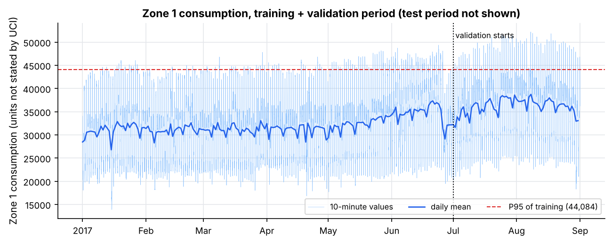
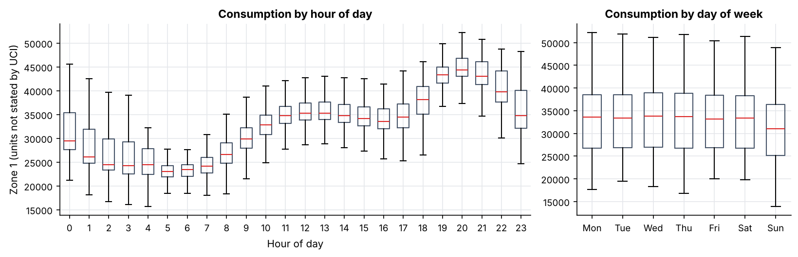
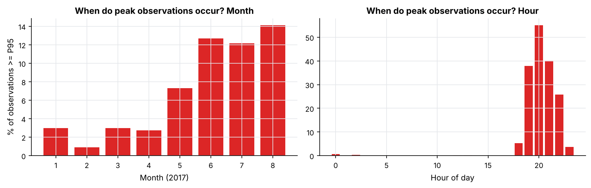
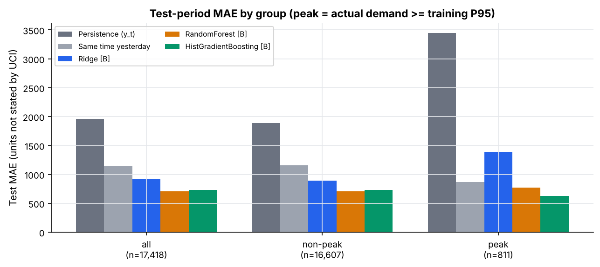
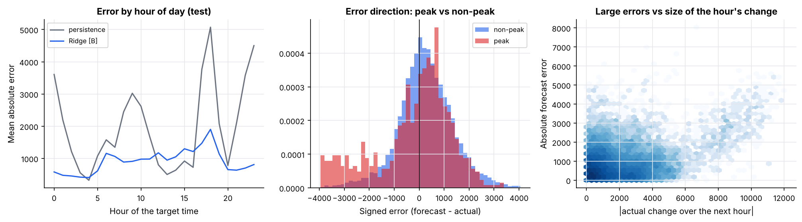
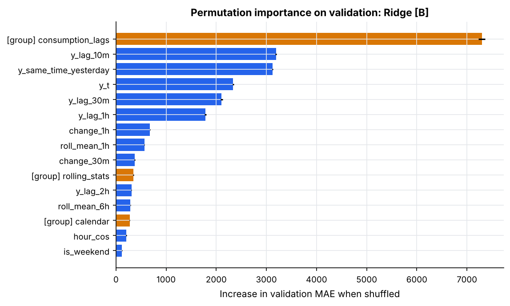

# PeakLoad Lens: Weather-Aware Peak Demand Forecasting and Error Analysis

A careful, reproducible study of **one-hour-ahead electricity-demand forecasting** for Zone 1 of Tetouan City (Morocco), built on 10-minute smart-grid style data. The project audits the data, builds leakage-checked time-series features, compares simple baselines with three standard Scikit-learn regressors under a **chronological** evaluation, and puts **peak-demand error analysis** and a **controlled test of whether weather helps** at the centre.

> All numbers in this README come from the code in this repository (`python src/forecasting.py`, outputs in `outputs/results/`). Nothing is estimated by hand. The units of consumption and weather values are **not stated by the dataset source**, so error values are reported in the dataset's own units.

## Research questions

1. How accurately can Zone 1 consumption be forecast one hour ahead?
2. Does a machine-learning model beat simple baselines (persistence, same time yesterday)?
3. Are errors larger during peak demand than at other times?
4. Do weather features improve forecasts, and when are the largest errors made?

This is not claimed to be a novel research contribution; it is a transparent, defensible analysis of a public dataset.

## Dataset

* **Power Consumption of Tetouan City**, UCI Machine Learning Repository: <https://archive.ics.uci.edu/dataset/849/power+consumption+of+tetouan+city>
* License: **CC BY 4.0**. The raw CSV is *not* committed here (download it yourself, see `data/README.md`).
* 52,416 rows × 9 columns, 10-minute observations from 2017-01-01 00:00 to 2017-12-30 23:50: `DateTime`, `Temperature`, `Humidity`, `Wind Speed`, `general diffuse flows`, `diffuse flows`, and consumption for Zone 1, 2 and 3. Zone 1 is the target here.

**Citation.** Salam, A. & El Hibaoui, A. (2018). *Power Consumption of Tetouan City* [Dataset]. UCI Machine Learning Repository. <https://doi.org/10.24432/C5B034>. Introductory paper: Salam, A. and El Hibaoui, A. (2018), "Comparison of Machine Learning Algorithms for the Power Consumption Prediction: Case Study of Tetouan city", International Renewable and Sustainable Energy Conference.

## Data audit (summary)

| Check | Finding |
|---|---|
| Rows | 52,416 (the UCI page lists 52,417; the one-row difference most likely counts the header). Last day of the year (31 Dec) is absent |
| Timestamps | Parse correctly (`m/d/Y H:M`), chronological, **no duplicates, no gaps** (every step is exactly 10 minutes) |
| Missing / non-numeric / non-positive values | None |
| Extreme values | Diffuse-flow variables are heavily skewed (expected for solar-type data); Zone 3 has 18 extreme points; kept |
| Abrupt jumps | 4 Zone 1 drops larger than 8,000 in 10 minutes (kept; they show up in the error analysis) |
| Units | Not stated by the source for any column |

No row was removed, filled or interpolated. The cleaning step only renames columns, parses dates and **asserts** the 10-minute grid (it raises an error rather than hiding a problem). Full report: `outputs/results/audit_report.md`.

## Prediction setup

* **Forecast origin *t***, **target** = Zone 1 consumption at exactly *t + 1 hour*. The target is built by timestamp lookup and cross-checked against a 6-row shift; all origin→target gaps are exactly one hour.
* **Allowed inputs:** consumption and weather observed at or before *t*, plus calendar fields of the target time (known in advance). **Not used:** any future consumption or weather.
* A **perturbation test** in the notebook multiplies all post-origin observations by random noise and confirms the features at the origin do not change.
* Rows dropped: 6 origins at the end of the data (no target) and 143 at the start (not enough history for the 24-hour features); 6 boundary rows at the end of each of train and validation are purged so targets never cross into the next split.

## Features (24 in set B)

* **Consumption history:** latest value, lags of 10 min / 30 min / 1 h / 2 h, the value at the target's clock time yesterday, 30-min and 1-h changes.
* **Rolling statistics** (windows end at *t*): mean/std over 1 h and 6 h, mean over 24 h.
* **Calendar of the target time:** cyclical hour and weekday, weekend flag.
* **Weather at the origin (set B only):** temperature, humidity, wind speed, the two diffuse-flow variables, and 1-hour temperature change.

Set **A** = history + rolling + calendar (18 features); set **B** = A + 6 weather features. Each feature and its rationale is in `outputs/results/feature_list.csv`. No day-of-year or holiday features were added (one year of data cannot teach them).

## Chronological evaluation design

| Split | Period | Origins |
|---|---|---|
| Train | 1 Jan - 30 Jun | 25,915 |
| Validation | 1 Jul - 31 Aug | 8,922 |
| Test | 1 Sep - 30 Dec | 17,418 |

**Why this split (full disclosure).** Demand is strongly seasonal: peaks occur mostly May-Oct. With a threshold learned on Jan-Aug, November and December contain **zero** peak observations, so a conventional "last two months" test set could not answer question 3. Before fitting any model I fixed a rule (test window must contain peaks on at least ~40 separate days; training at least 6 months). This split satisfies it (811 test peak observations on 49 days). **The split was chosen after looking at monthly demand levels (including the test months), but before any model was trained.** The price is that the training window lacks the summer months.

**Protocol.** Models are compared on validation MAE (fit on train only). For the test period each model is refit on train + validation with the same fixed hyper-parameters. Nothing is re-chosen after seeing test results. Hyper-parameters are fixed and untuned.

**Peak definition.** Actual target demand at or above the **95th percentile of training targets** (44,084; sensitivity: P90 = 42,520). This is retrospective error analysis, not a claim that peaks can be known in advance.

## Models and baselines

Persistence (`y_t`); same time yesterday; Ridge; Random Forest; HistGradientBoosting (Scikit-learn; scaler fitted inside a pipeline on training rows; boosting early-stopping off because its default uses a random hold-out). Metrics: MAE, RMSE (and MAPE); confidence intervals use a **day-block bootstrap** because neighbouring 10-minute errors are strongly dependent.

## Results

### Overall error (MAE / RMSE, dataset units)

| Model | Validation MAE | Validation RMSE | Test MAE | Test RMSE |
|---|---:|---:|---:|---:|
| Persistence | 2,411 | 3,197 | 1,964 | 2,736 |
| Same time yesterday | 1,423 | 2,116 | 1,143 | 1,660 |
| Ridge [A] | 1,130 | 1,553 | 899 | 1,234 |
| Random Forest [A] | 1,201 | 1,590 | 725 | 1,021 |
| HistGradientBoosting [A] | 1,257 | 1,640 | 752 | 1,022 |
| **Ridge [B]** (lowest validation MAE) | **1,117** | 1,536 | **915** | 1,243 |
| Random Forest [B] | 1,181 | 1,565 | 709 | 1,009 |
| HistGradientBoosting [B] | 1,360 | 1,749 | 729 | 993 |

* **Pre-specified selection** by validation MAE picks **Ridge [B]**. On test it is **53.4% lower MAE than persistence** and **19.9% lower than same-time-yesterday** (MAE 915 vs 1,964 and 1,143; MAPE 3.0%; mean test demand ≈ 31,077).
* **The ranking changes on test:** Random Forest [B] has the lowest test MAE (709) but was *not* selected on validation, and I did not swap it afterwards. On validation, tree models under-forecast (bias about -400 vs -57 for Ridge), consistent with sparse high-demand coverage in the Jan-Jun training data (a plausible explanation, not proven).

### Peak vs non-peak (test period, peak = actual target ≥ training P95; 811 peak / 16,607 non-peak observations)

| Model | Peak MAE | Non-peak MAE | Ratio (95% day-block CI) | Peak bias (forecast - actual) |
|---|---:|---:|---|---:|
| Persistence | 3,447 | 1,891 | 1.82 (1.73-1.91) | -2,556 |
| Same time yesterday | 865 | 1,156 | 0.75 (0.59-0.93) | -263 |
| Ridge [B] | 1,387 | 892 | 1.56 (1.43-1.70) | -494 |
| Random Forest [B] | 769 | 706 | 1.09 (0.96-1.21) | -625 |
| HistGradientBoosting [B] | 630 | 734 | 0.86 (0.74-0.99) | -286 |

* Persistence errors are far larger at peaks. The **validation-selected Ridge model is clearly worse on peaks than off-peak, and worse on peaks than the "same time yesterday" baseline.**
* Tree models show no reliable peak penalty **on test**, but **on the validation period every learned model was worse on peaks** (ratios ≈ 1.2-1.5), so this result is not robust across periods.
* **Every model under-forecasts peaks on average.** The P90 sensitivity check leaves the test-period contrasts essentially unchanged.
* Peaks are not random spikes: they are **evening (19:00-22:00) events concentrated in May-August** in the training/validation data.

### Does weather help? (set B vs set A, test / validation MAE change)

| Model | Test MAE A → B | Test change | Validation MAE A → B | Validation change |
|---|---|---:|---|---:|
| Ridge | 899 → 915 | +1.8% (worse) | 1,130 → 1,117 | -1.1% |
| Random Forest | 725 → 709 | -2.2% | 1,201 → 1,181 | -1.6% |
| HistGradientBoosting | 752 → 729 | -3.0% | 1,257 → 1,360 | **+8.2% (worse)** |

The effect of adding weather is **small and inconsistent in sign**. I cannot claim that weather improves these forecasts. Permutation importance on validation (model fitted on training only) ranks the consumption-history group first (MAE +7,298 when shuffled), then rolling statistics (+345), calendar (+274) and the **weather group last (+55)**. Importance shows what the fitted model relies on, **not causation**. The intervals ignore re-training variability and use only observed (not forecast) weather.

### Where the largest errors occur (validation-selected model, test)

* The worst 1% of forecasts (175) are concentrated at target hours **17:00-19:00** (~55% of them, ~31% at 18:00 alone, vs ~4% per hour if uniform): the **evening ramp-up**, plus a smaller cluster near 15:00.
* In these cases the actual change over the next hour is large (mean ≈ 5,800 vs ≈ 1,900 otherwise) and the forecast stays near the current level; **abrupt ramps and drops that the history does not foreshadow are the dominant failure mode.**
* They are far more often peak observations (30% vs 4%), mostly in September-October (83% vs 50% of all forecasts), with higher temperature and lower humidity on average. This is an **association entangled with season and time of day, not evidence that weather causes the errors**. Across all forecasts, error size correlates only weakly with the next-hour change (Spearman ≈ 0.13); the large misses are a minority tail.
* The data cannot say *why* demand ramps or drops abruptly (no event, outage, holiday or behaviour information).

### Figures

| | |
|---|---|
|  |  |
|  |  |
|  |  |

All figures: `outputs/figures/` (EDA uses training + validation data only; the test period is not used for EDA).

## Practical implications (not measured benefits)

Forecasts of this kind could help flag evening-ramp hours in warm months as higher risk for under-forecasting, and "same time yesterday" is a cheap, strong safeguard to compare any model against. **No cost saving, reliability gain or deployment benefit was measured.**

## Limitations

* One city, three zones, one year (2017): seasons, holidays and rare events occur at most once; results may not generalise to other cities, years or climates.
* Split chosen to make peak analysis possible; the training window lacks summer, which affects the validation ranking.
* Hyper-parameters not tuned; rankings could change with tuning.
* Only observed weather at the origin was used; genuine weather forecasts could behave differently.
* Bootstrap intervals resample days but ignore re-training variability; the peak group spans ~49 test days.
* Units are not documented by the source; the two diffuse-flow variables are undefined.

**Next steps:** walk-forward evaluation across months, additional years of data, tuning on walk-forward folds, quantile forecasts for peaks, a clearly labelled experiment with real weather forecasts, and Zones 2 and 3.

## Reproduce

```bash
git clone <your-repo-url> && cd PeakLoad-Lens
python -m venv .venv && source .venv/bin/activate      # Windows: .venv\Scripts\activate
pip install -r requirements.txt
# download "Tetuan City power consumption.csv" from UCI into data/  (see data/README.md)
python src/data_audit.py          # audit report -> outputs/results/audit_report.md
python src/forecasting.py         # all figures and tables (about 1-2 minutes)
jupyter lab notebooks/peakload_lens_analysis.ipynb   # narrated walk-through
```

To use a different file location: `python src/forecasting.py --data /path/to/file.csv` or set `PEAKLOAD_DATA`. Seeds are fixed (`42`). The code was developed and run with Python 3.13, pandas 3.0, NumPy 2.5, Matplotlib 3.11, Scikit-learn 1.9.

## Project structure

```
PeakLoad-Lens/
├── data/README.md                      where to put the downloaded CSV (CSV not committed)
├── notebooks/peakload_lens_analysis.ipynb
├── src/data_audit.py                   loading, audit, working frame
├── src/forecasting.py                  features, models, peak/error analysis, figures
├── outputs/figures/                    10 PNG figures
├── outputs/results/                    CSV/JSON/Markdown result tables
├── requirements.txt
└── .gitignore
```

## Libraries

Python, pandas, NumPy, Matplotlib, Scikit-learn, Jupyter.

## Acknowledgment

Data © the dataset creators (Abdulwahed Salam and Abdelaaziz El Hibaoui, Abdelmalek Essaadi University), shared via the UCI Machine Learning Repository under CC BY 4.0.
